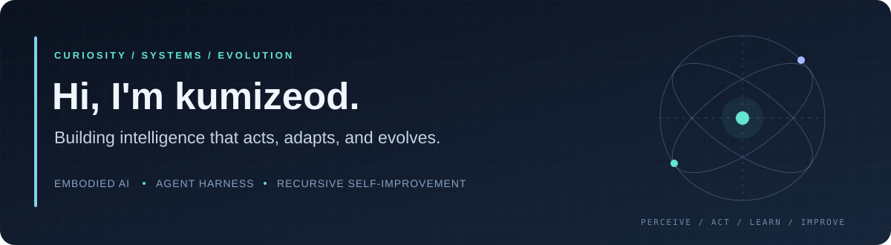

  <code>Software Engineering @ DUT</code>
  <code>Embodied AI</code>
  <code>Agent Harness</code>
  <code>Recursive Self-Improvement</code>

  <samp>
    <a href="https://github.com/kumizeod?tab=repositories">Builds & Experiments</a> ·
    <a href="https://github.com/kumizeod?tab=stars">Reading & Inspiration</a> ·
    <a href="#what-keeps-me-up-at-night">Research Interests</a>
  </samp>

Hi, I'm **kumizeod**, a software engineering student at **Dalian University of Technology**.

I'm drawn to one ambitious question: **how do we build intelligence that can act in the real world, carry out sustained work, and improve the way it learns?**

- 🤖 **Embodied intelligence** — exploring the loop from perception and world models to planning, action, and feedback. Intelligence gets interesting when it has to meet reality.
- 🛠️ **Agent harnesses** — interested in the infrastructure that turns model capability into dependable execution: tools, memory, context, orchestration, and evaluation.
- 🔁 **RSI** — fascinated by recursive self-improvement: systems that can inspect their failures, refine their methods, and earn their next capability through measurable progress.
- 🚀 I enjoy turning ambitious ideas into working systems, tracing problems across the stack, and pushing prototypes until the hard questions become concrete.

> **The ambition: build systems that act with purpose, learn from experience, and compound their capabilities.**

## What keeps me up at night

| Direction | Questions I'm exploring |
| :--- | :--- |
| **Embodied AI** | How can perception, reasoning, and action stay grounded in a changing physical world? |
| **Agent Harness** | What runtime, memory, and feedback loops let agents stay useful over long tasks? |
| **Recursive Self-Improvement** | How can systems improve their own strategies while keeping progress testable and reproducible? |

My north star is the intersection: **agents that learn by doing, harnesses that make execution reliable, and feedback loops that turn experience into improvement.**

## Builder's mindset

**Think from first principles. Build the whole loop. Let experiments settle the argument.**

I'm especially interested in thoughtful engineering, ambitious research ideas, and open-source work that makes advanced AI easier to understand and build on. If you're exploring embodied agents, agent infrastructure, or self-improving systems, I'd love to connect through GitHub.

具身智能，让智能走进真实世界。Harness，让能力变成可靠执行。RSI，让每一次探索都成为下一次进化的起点。

---

Curiosity sets the direction. Engineering makes it real. Feedback moves it forward.
